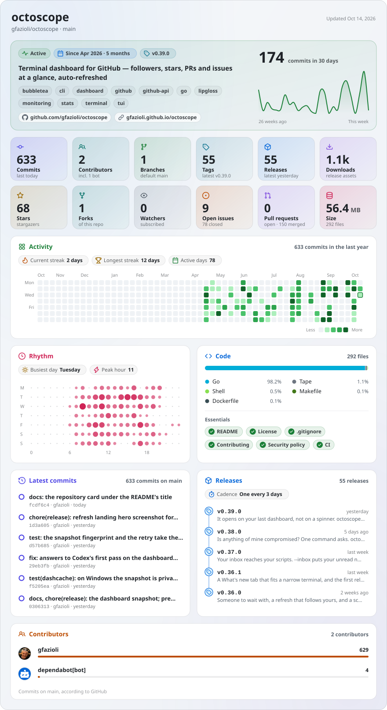

<div align="center">

# glancecard

**Your GitHub profile and repositories, at a glance.**<br/>
Daily SVG cards for your READMEs, rendered by GitHub Actions in your own repository: no server, no third-party service, no dependencies.

[](https://github.com/gfazioli/glancecard/actions/workflows/ci.yml)


<br/>

<picture>
  <source media="(prefers-color-scheme: dark)" srcset="docs/examples/octoscope-dark.svg">
  
</picture>

<sub>A repository card, snapshot of <a href="https://github.com/gfazioli/octoscope">gfazioli/octoscope</a>. It follows your GitHub theme.</sub>

</div>

## What you get

- **A repository card** for any public repository: status, age and latest tag, description and topics, commits in the last 30 days with a 26-week sparkline, twelve stat tiles, a year of commits with streaks, the weekly rhythm (day × hour), languages and essentials (README, license, contributing guide, security policy, CI), the latest commits and releases with their cadence, contributors.
- **A profile card** for any user: followers, stars, repositories, pull requests, issues, commits, the contribution calendar, the most starred repositories and their languages.
- **Both themes**: a dark and a light file per card, and a `<picture>` that shows the one matching the reader's GitHub theme.
- **Refreshed by your own workflow**, on your schedule, with the token GitHub Actions already gives every run. The cards are plain files committed to your repository.

## Quick start

**1. Add a workflow** to the repository that will hold the cards — your profile repository (`<you>/<you>`) is a good home, since its README is the first one people see:

```yaml
# .github/workflows/glancecard.yml
name: glancecard

on:
  schedule:
    - cron: "30 5 * * *" # every day
  workflow_dispatch:

permissions:
  contents: write

jobs:
  cards:
    runs-on: ubuntu-latest
    steps:
      - uses: actions/checkout@v7
      - uses: gfazioli/glancecard@v0.1.0
        with:
          profile: your-login
          repos: |
            your-login/your-repo
            your-login/another-repo
```

**2. Run it once** from the Actions tab (*Run workflow*). It commits `glancecard/profile-dark.svg`, `glancecard/profile-light.svg` and a pair per repository.

**3. Show a card** in a README. In the same repository:

```html
<picture>
  <source media="(prefers-color-scheme: dark)" srcset="glancecard/your-repo-dark.svg">
  
</picture>
```

From another repository, point at the raw file instead: `https://raw.githubusercontent.com/<you>/<you>/main/glancecard/your-repo-dark.svg`. That way a project's own history gets no bot commits; the cards live, and refresh, in one place.

## Inputs

| Input | Default | |
|---|---|---|
| `repos` | | Repositories, as `owner/name`, separated by newlines, commas or spaces. |
| `profile` | | A login to render a profile card for. |
| `out-dir` | `glancecard` | Folder the cards are written to, relative to the workspace. |
| `theme` | `both` | `dark`, `light`, or `both`. With one theme the file is `<name>.svg`. |
| `time-zone` | `UTC` | IANA zone, such as `Europe/Rome`, for the commit calendar and rhythm. |
| `sections` | `all` | Repository card sections to draw: `hero`, `tiles`, `activity`, `rhythm`, `code`, `commits`, `releases`, `contributors`. When one of a side-by-side pair is left out, the other takes the full width. |
| `max-commits` | `5000` | Commits read for the last year, at most. A busier repository says so on its card. |
| `allow-private` | `false` | Render private repositories too. Read the note on privacy first. |
| `commit` | `true` | Commit and push the cards. On a pull request they are only rendered. |
| `commit-message` | `chore: refresh glancecard` | |
| `token` | `${{ github.token }}` | Token the API is read with. |

**Outputs:** `files`, the cards written (one path per line), and `committed`, `true` when a commit was pushed.

Repository cards are named after the repository (`octoscope-dark.svg`); two repositories with the same name from different owners become `owner-name`. The profile card is `profile-dark.svg` and `profile-light.svg`.

## Preview from a terminal

```sh
npx github:gfazioli/glancecard repo your-login/your-repo --out cards
npx github:gfazioli/glancecard profile your-login --out cards
```

The token is read from `GITHUB_TOKEN`, then `GH_TOKEN`, then `gh auth token`. `--help` lists the options; they mirror the inputs above, and the time zone defaults to your machine's.

## Questions

**Why does it commit to my repository?** A README image has to be a file somewhere. Committing it keeps everything inside GitHub, with no service to trust or keep alive. Commits pushed with the workflow token start no other workflow, and they keep the repository active, which is what stops GitHub from disabling the schedule of a public repository after 60 quiet days.

**How fresh is a card?** As fresh as your schedule. GitHub caches a raw file for about five minutes, and scheduled runs often start late.

**Privacy.** With the default token a card shows what anyone can see. A personal token can see private repositories, so glancecard refuses them unless you set `allow-private: true`: their card would publish their activity wherever it is committed. The profile card counts public repositories only; its contribution calendar is the one GitHub computes for the token's viewer.

**Rate limits.** A repository card costs a handful of requests, plus one per hundred commits of the last year and one per hundred releases. The workflow token allows 1,000 REST requests and 1,000 GraphQL points an hour per repository: dozens of cards per run.

**Time zone.** GitHub returns commit times in UTC and drops the author's offset, so the calendar and the rhythm are read in the zone you give.

**Fonts.** An SVG shown as an image can't load fonts or measure its text, so the cards use the system font and estimate its widths from tables measured in a browser. On macOS, Windows and Linux the text fits; CI screenshots the cards on Linux and Windows to keep it that way.

## Development

Node 20 or later, no dependencies.

```sh
npm test            # unit tests and the golden cards
npm run golden      # rewrite test/golden/ after a deliberate change to a card
npm run preview     # render the golden cases into preview/ and screenshot them with Chrome
node scripts/record-fixture.js owner/name test/fixtures/name.json   # record a new fixture
```

The golden cards are rendered from recorded API data at the instant it was recorded, so they only change when the drawing does. Look at `npm run preview` before committing new ones.

## Credits

The repository card's layout follows the repository view of [FinderGit](https://findergit.app), a Git-aware file browser for macOS. Icons are [Octicons](https://github.com/primer/octicons) (MIT).

## License

[MIT](LICENSE) © Giovambattista Fazioli
